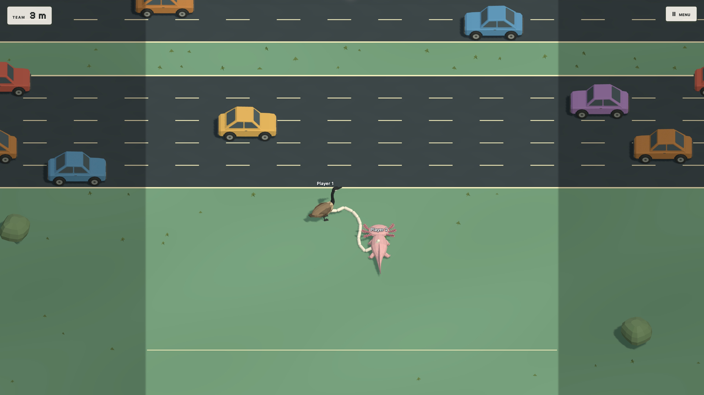
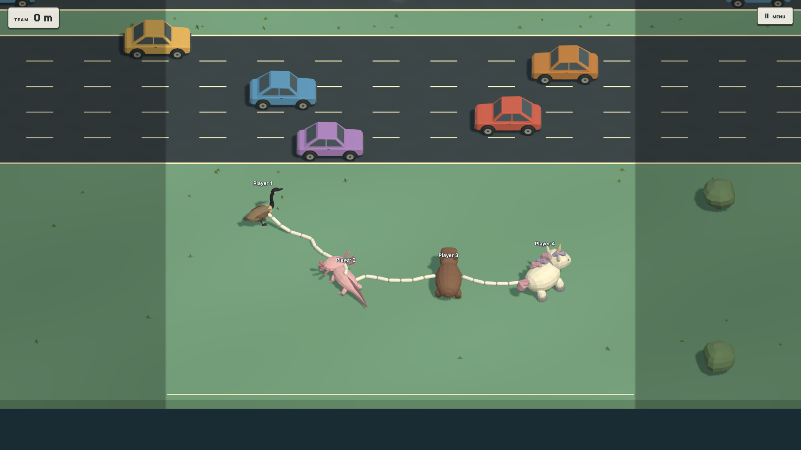
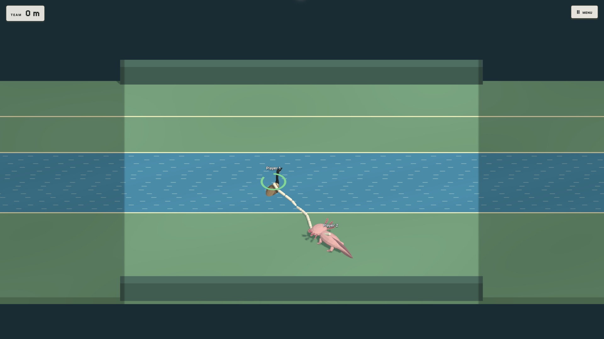
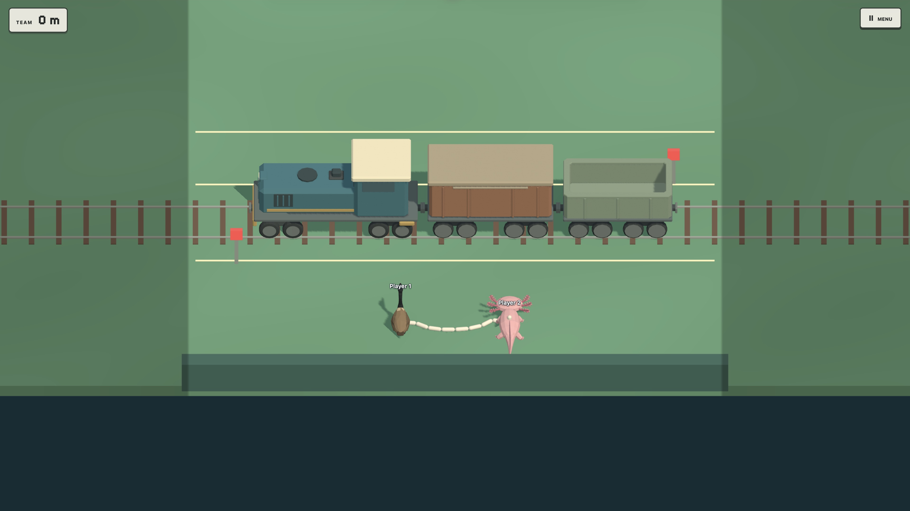
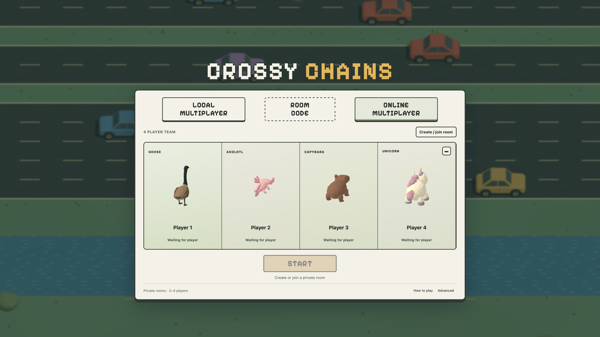

# Crossy Chains

**A physics-driven cooperative browser game for 2–4 players.**



Crossy Chains connects teammates with a simulated physical chain. Players coordinate their movement to cross traffic, rivers, and railways while the chain transmits forces and catches on obstacles.

**TypeScript · Three.js · Rapier · Colyseus · Vite**

**Status:** Core gameplay implemented; public hosting and multiplayer device validation remain pending. No hosted demo is currently available.

[Run locally](#run-locally) · [Engineering](#engineering-highlights) · [Screenshots](#gameplay-gallery) · [Architecture](docs/ARCHITECTURE.md) · [Assets & attribution](docs/ASSETS.md)

## The game

Move freely through an endless world of traffic, flowing rivers, and railway crossings. The team shares one run: a vehicle impact or failed water crossing ends the attempt, and progress depends on keeping the group together. The four fixed character slots are a goose, an axolotl, a capybara, and a unicorn.

- **Physical cooperation:** chain links transmit forces between teammates and collide with posts and river rocks.
- **Seeded endless terrain:** repeatable worlds from a seed, safe areas to regroup, bounded difficulty, and sections loaded as the team advances.
- **Private rooms:** invitation links, ready checks, and seat recovery after a disconnect. Restarting an online endless run requires every player's vote.
- **Animated characters:** separate walking and swimming animations, playback tied to movement, and visual models separated from collision bodies. Runtime artwork was developed with Blender; Blender is not needed to run the game.

### Ways to play

- **Shared keyboard:** two players on one desktop; no multiplayer backend required.
- **Online rooms:** two to four desktop clients connected to the authoritative server.
- **Phone controllers:** two to four phones control players on one shared desktop display.

## Engineering highlights

### Physical chains that change movement

Dynamic capsule spans and spherical joints share a Rapier world with the players. Bounded drive forces yield to contact and tension, so the chain affects movement rather than following it as a visual effect. See the [chain assembly](packages/simulation/src/chain.ts) and [physics simulation](packages/simulation/src/simulation.ts).

### One authoritative connected assembly

The server simulates the entire connected group. Clients interpolate players and chain segments on one snapshot timeline rather than predicting each body independently. See the [authoritative session](apps/server/src/authoritative-session.ts) and [snapshot buffer](apps/game/src/snapshot-buffer.ts).

### Input safety and session recovery

Ownership generations, input sequencing, and 250 ms freshness checks reject stale commands. Disconnects pause the shared simulation; reconnecting does not replay previously held input. See the [input scheduler](apps/server/src/input-scheduler.ts) and [room lifecycle](apps/server/src/transport-room.ts).

### Seeded world generation and streaming

The server generates terrain from versioned, seeded world descriptors. Feasibility checks and streaming margins account for the group and chain, not just one character. See the [world generator](packages/config/src/generated-world.ts) and [simulation-side terrain](packages/simulation/src/generated-world.ts).

### Efficient rendering and resource ownership

Shared glTF templates, character batching, instanced scenery, pooled effects, and bounded section disposal reduce repeated work. See [character batching](apps/game/src/character-batch.ts), [world rendering](apps/game/src/generated-world-view.ts), and [visual effects](apps/game/src/visual-effects.ts).

[Architecture and tradeoffs](docs/ARCHITECTURE.md) explains the physics, protocol, room lifecycle, and rendering boundaries in more detail.

## Verification

The automated suite covers physics and hazards, seeded generation, protocol validation, snapshot interpolation, and multiplayer room lifecycle, including real local socket fixtures. Representative tests include [chain behavior](packages/simulation/src/chain.test.ts), [full-assembly interpolation](apps/game/src/group-timeline.test.ts), and [two-client transport](apps/server/src/transport.test.ts).

Type checking and the production build passed in the documented local review. Two network cases failed during the full test run and passed when rerun individually; the suite is not documented as fully passing. See the [verification record](docs/VERIFICATION.md) for the environment, exact outcomes, and limits of those checks.

## Gameplay gallery

### Four-player chain



All four character slots in one authoritative room on loopback. Three seats were controlled by local SDK clients; this capture does not establish four-person play across devices.

### River crossing



Swimming animation and water-exposure feedback during a chained crossing.

### Railway crossing



The railway course brings train timing and warning lamps into the team's route.

### Team setup



Online team setup before creating a room. Characters are assigned to fixed seats.

All screenshots are authentic captures of this implementation. [Capture notes](docs/media/README.md) describe their setup and provenance.

## Run locally

Use **Node.js 24.x** and its bundled npm, plus a desktop browser supporting WebGL2. The tested Node.js version is recorded in [`.node-version`](.node-version).

```sh
git clone https://github.com/mahir08fr/crossy-chains-game.git
cd crossy-chains-game
npm ci
```

### Quick local preview — one terminal

```sh
npm run dev
```

Open **http://127.0.0.1:5173/local.html**, choose **Ready** on both cards, then **Start**. Player 1 uses **WASD**; Player 2 uses the **arrow keys**. A solo reviewer can control the two seats in turn to explore the chain behavior. **How to play** explains the hazards; **Advanced** offers focused road, river, and railway courses.

### Desktop multiplayer — two terminals

Run both commands from the repository root.

**Terminal 1 — backend:**

```sh
npm run dev:server
```

**Terminal 2 — frontend:**

```sh
npm run dev
```

Open **http://127.0.0.1:5173/** in two visible browser windows. Configure the team size, create a private room, and share its invitation. Guests choose **Ready**; the host chooses **Start**, which also confirms the host's readiness. Keep both windows visible; backgrounding a participant intentionally triggers safety pauses.

[Full setup instructions](docs/SETUP.md) cover phone controllers, Windows and LAN configuration, development entry points, verification commands, and production preview. Press **Ctrl+C** in each server terminal when finished.

## Source map

- [`apps/game/`](apps/game/) — browser interface, input, Three.js rendering, and animation.
- [`apps/server/`](apps/server/) — Colyseus runtime, room lifecycle, and authoritative sessions.
- [`packages/simulation/`](packages/simulation/) — Rapier physics, chain assembly, and hazard rules.
- [`packages/config/`](packages/config/) — shared parameters and seeded world descriptors.
- [`packages/protocol/`](packages/protocol/) — wire contracts, validation, and compact snapshots.
- [`assets/`](assets/) — the 17 game-ready GLBs required by source and tests.
- [`scripts/`](scripts/) — traversal fixtures and a local npm compatibility helper; see the [development guide](docs/SETUP.md#development-workflow).
- [`docs/`](docs/) — architecture, setup, verification, attribution, and gameplay media.

Start with the [authoritative session](apps/server/src/authoritative-session.ts), [physics simulation](packages/simulation/src/simulation.ts), [world generator](packages/config/src/generated-world.ts), or [character view](apps/game/src/character-view.ts).

## Status

This repository is a curated source snapshot; its public history begins with the source release. Core gameplay is implemented, while public hosting capacity, four-person play across devices, and long-session reliability remain unverified. No hosted demo is currently available. Audio is not implemented.

Local gameplay and automated fixtures provide evidence for the tested paths; they do not establish public multiplayer release readiness. See the [verification record](docs/VERIFICATION.md).

## Rights

Original project code and artwork are published for portfolio and educational inspection; no open-source licence is granted. Public visibility does not grant permission to reuse, redistribute, or commercially exploit the original code or artwork. Third-party components retain their own licence terms. See [assets and third-party notices](docs/ASSETS.md).
