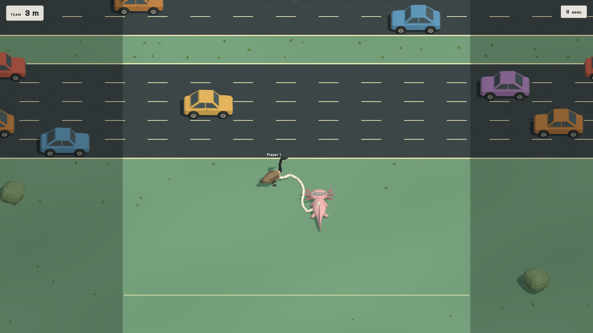
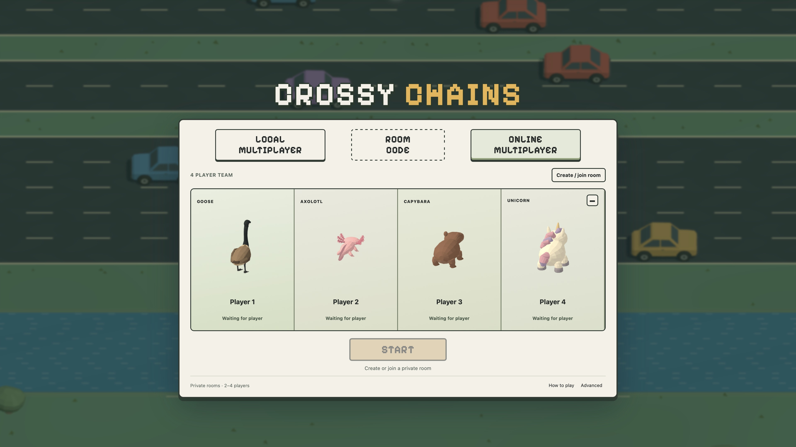
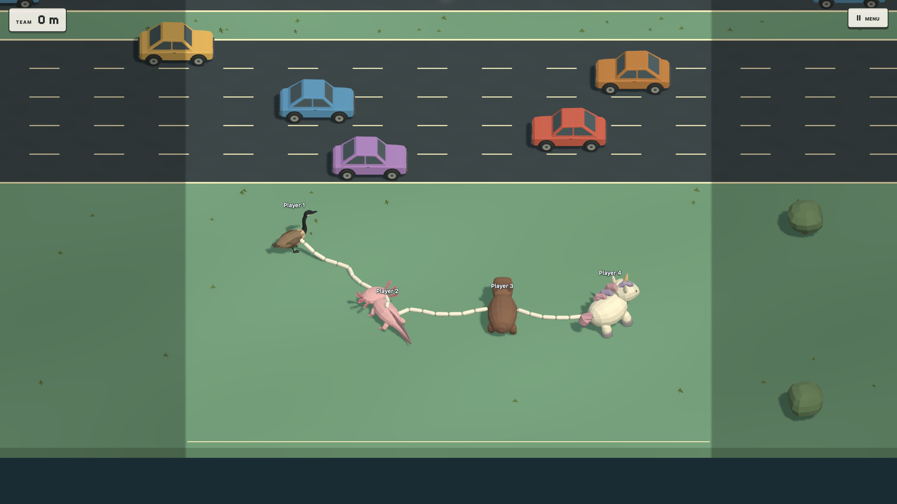
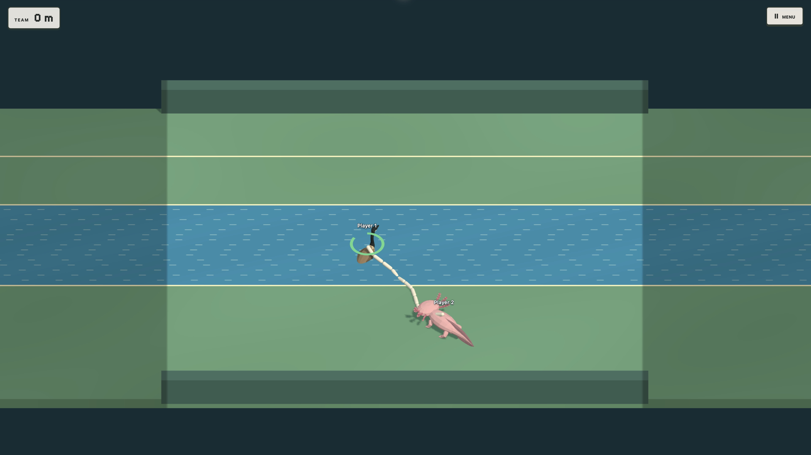
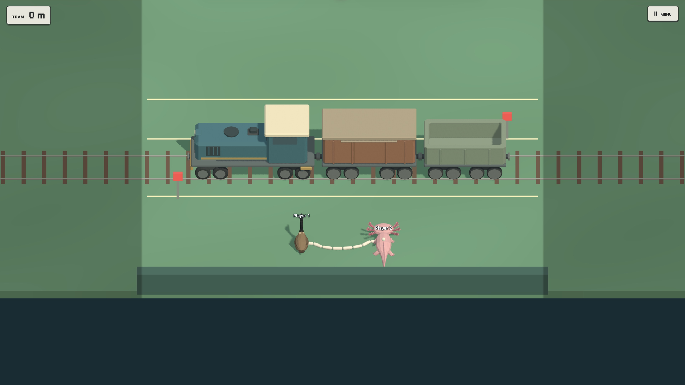

# Crossy Chains

**A physics-driven cooperative crossing game for 2–4 players.**



Crossy Chains turns obstacle crossing into a coordination problem: a physical chain connects the team, catches against obstacles, and carries the consequences of each player's movement.

**TypeScript · Three.js · Rapier · Colyseus · Vite · Blender**

[Architecture](docs/ARCHITECTURE.md) · [Local setup](docs/SETUP.md) · [Assets & attribution](docs/ASSETS.md)

## The game

Move freely through an endless world of traffic, flowing rivers and railway crossings. The team shares survival and progress: leaving a teammate behind is not a way to win. Four fixed character slots bring a goose, axolotl, capybara and unicorn into the same physical assembly.

- **2–4 players:** private online rooms, invitations, readiness and controlled session recovery.
- **Physical cooperation:** connected rigid-body chains transmit forces and collide with posts and river rocks.
- **Multiple ways to play:** two people sharing a keyboard, separate desktop clients, or phones controlling a shared display.
- **Seeded endless terrain:** compact crossings, regrouping strips, bounded difficulty and streamed sections.
- **Shared consequences:** vehicle impacts and failed water crossings end the run; generated multiplayer restarts require the team's agreement.
- **Custom characters:** separate walking and aquatic clips, movement-driven playback and visual attachments independent of collision bodies.

## Gameplay gallery

| Team setup | Four-player chain |
| --- | --- |
|  |  |
| **River crossing** | **Railway crossing** |
|  |  |

## Engineering highlights

| Challenge | Implementation |
| --- | --- |
| A chain that changes movement | Dynamic capsule spans and spherical joints share a Rapier world with the players. Bounded drive forces yield to contact and tension. |
| Synchronizing a connected assembly | The server advances the complete group. Clients interpolate players and chain segments on one snapshot timeline rather than predicting each body independently. |
| Handling interrupted input | Ownership generations, input sequencing and 250 ms freshness checks reject stale commands. Disconnects pause the connected world; reclaim does not replay held input. |
| Building an endless course | Versioned seeded descriptors define authoritative terrain. Feasibility checks and streaming margins account for the group and chain, not just one character. |
| Keeping presentation affordable | Shared GLTF templates, character batching, instanced scenery, pooled effects and bounded section disposal reduce repeated work. |

## Source map

```text
apps/game/           Browser interface, input, Three.js rendering and animation
apps/server/         Colyseus runtime, room lifecycle and authoritative sessions
packages/simulation/ Rapier physics, chain assembly and hazard rules
packages/config/     Shared parameters and seeded world descriptors
packages/protocol/   Wire contracts, validation and compact snapshots
assets/              The 17 game-ready GLBs required by source and tests
docs/                Architecture, setup and gameplay media
```

Start with [the authoritative session](apps/server/src/authoritative-session.ts), [physics simulation](packages/simulation/src/simulation.ts), [world generator](packages/config/src/generated-world.ts), or [character view](apps/game/src/character-view.ts).

## Run locally

Use **Node.js 24.x** with npm (the checked version is recorded in `.node-version`).

```sh
git clone https://github.com/mahir08fr/crossy-chains-game.git
cd crossy-chains-game
npm ci
```

In two terminals:

```sh
npm run dev:server
```

```sh
VITE_SERVER_URL=http://127.0.0.1:2567 npm run dev -- --port 5173 --strictPort
```

Open **http://127.0.0.1:5173/local.html** for two-player shared-keyboard play, or **http://127.0.0.1:5173/** for online room setup. Choose Ready on each local card, then Start. P1 uses WASD; P2 uses the arrow keys.

```sh
npm run typecheck
npm test
npm run build
```

[Full setup instructions](docs/SETUP.md) cover private rooms, phone controllers, environment variables and production preview.

## Status

**Development complete; public multiplayer release pending final hosting and device validation.**

This is a source-visible portfolio snapshot, not an announced public game launch. Automated checks and local gameplay do not establish public hosting capacity, real four-person reliability or long-session device acceptance. No production demo is advertised here. Audio and rescue quick-time events are not implemented.

## Rights

Source code is publicly available for portfolio and educational inspection. No open-source licence is granted for the original project code or artwork. Third-party components remain subject to their own licence terms. Public visibility does not grant permission to reuse, redistribute or commercially exploit the original project code or artwork.
