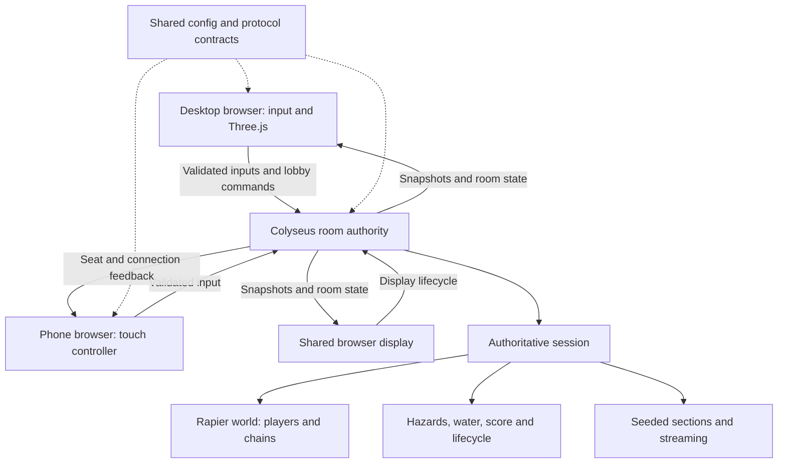

# Architecture

[Back to the project](../README.md) · [Setup](SETUP.md)

Crossy Chains separates authoritative gameplay from presentation. The online server owns the complete connected physical assembly. A phone is an input device; a shared display renders the room without simulating a competing world.

## Responsibilities

| Area | Main responsibility | Source |
| --- | --- | --- |
| Browser | Menus, keyboard/touch input, camera, interpolation, visual effects | [`apps/game/src`](../apps/game/src) |
| Server | Connection admission, room ownership, readiness, reclaim and authoritative stepping | [`apps/server/src`](../apps/server/src) |
| Simulation | Bodies, joints, contact, terrain, water and hazards; no DOM or Three.js | [`packages/simulation/src`](../packages/simulation/src) |
| Configuration | Movement/solver values, world descriptors and bounded difficulty | [`packages/config/src`](../packages/config/src) |
| Protocol | Wire shapes, compact codecs and validation | [`packages/protocol/src`](../packages/protocol/src) |

## Rooms and lifecycle

The Node.js runtime exposes Colyseus room types for transport diagnostics, private desktop play and phone-controller/shared-display play. The current process deliberately admits at most two rooms; that is a configured limit, not a measured hosting-capacity guarantee.

Private rooms fix a capacity of two, three or four seats. Readiness and host start are authoritative. Ownership can transfer when a participant disconnects. Reconnection credentials are distinct from invitation codes, and reclaim rotates the ownership generation. Generated multiplayer runs use unanimous restart voting. Empty and abandoned sessions are cleaned up rather than running indefinitely.

## Shared physical world

The simulation uses a 60 Hz fixed tick with bounded catch-up. Chained movement uses four substeps per tick, twelve solver iterations and two internal PGS iterations. Adjacent players share twelve dynamic capsule spans with spherical joints. Simple colliders govern gameplay; detailed character meshes never become player collision geometry.

Movement applies bounded forces. River currents and exposure/recovery timers belong to the authority. Swept player-hit checks cover traffic and trains. Supported rocks and posts contact the chain. Fault checks freeze invalid assemblies and explicit restart reconstructs the world.

[`FoundationSimulation`](../packages/simulation/src/simulation.ts) is reused by local modes and authoritative sessions. Local shared-keyboard play advances it in the browser; online clients do not advance a second Rapier world.

## Input and synchronization

Input commands carry sequences, connection generations, run generations and a server-time reference. The server validates shape, ownership and freshness. The 250 ms safety rules remain active across desktop and phone modes. Focus loss or stale input pauses or clears movement; reconnection does not restore held commands.

The server captures player poses, chain poses, hazards and run state. Compact snapshot tuples reduce wire overhead; validators enforce bounded, finite data. The browser buffers snapshots and interpolates the complete assembly on one timeline, including quaternion rotation for chain spans. It holds on underrun rather than inventing a future authoritative pose. Lifecycle changes clear old interpolation history.

## World generation and streaming

Versioned seeded generation defines constrained road, grass, river and railway sections. Descriptors carry deterministic layouts; the server owns selected sections, difficulty, progression and the rear boundary. Checks consider group clearance and transitions. Terrain removal uses full assembly margins so a trailing player or cable contact is not discarded just because the leader advanced.

Render-only horizontal extensions fill the visible camera span without expanding the playable physics bounds. Client-only decoration hashes authoritative section identifiers; trees and grass add no network state or tree colliders.

## Rendering and assets

Three.js loads Vite-managed GLB URLs through GLTFLoader. Eight character exports provide land and water clips for four fixed seats. Visual animation, yaw, model offsets, name tags and cinematic effects follow snapshots without modifying bodies.

Static traffic geometry is baked and reused; character batching preserves animated targets; scenery uses bounded instance buffers. Effects reuse pools. Section disposal and renderer teardown own their corresponding resources. The font is bundled with its original SIL OFL notice. See [asset provenance](ASSETS.md).

## Boundaries and tradeoffs

Authority simplifies connected-body consistency but leaves latency visible. Interpolation can create transient visual joint gaps; it does not rewrite physical constraints to hide them. Seeded checks constrain generation without proving every route's enjoyment. Automated tests demonstrate specific regressions and fixtures; real devices, human endurance and final public multiplayer acceptance remain separate gates.
